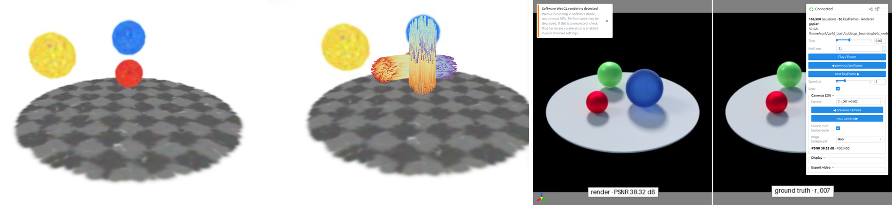

# gs4d_viewer — xem kết quả 4D Gaussian Splatting theo thời gian

[](https://github.com/zerokhong1/gs4d_viewer/actions/workflows/test.yml)

Viewer chạy trên trình duyệt (dựng bằng [viser](https://viser.studio)) để xem kết quả của các phương pháp 4D Gaussian Splatting (4DGS)
sau khi train: kéo thanh thời gian, play/pause, xoay camera quanh cảnh, xem Gaussian dạng splat hoặc dạng điểm, so sánh hai kết quả,
đối chiếu với ảnh gốc kèm PSNR, tô màu theo vận tốc, quay video theo quỹ đạo camera.

Viewer chỉ đọc **một định dạng `.npz` chung** ("Gaussian theo từng keyframe"). Mỗi phương pháp 4DGS có một converter đưa output về định
dạng đó; `python -m gs4d.open <output>` tự nhận ra loại output, chuyển và mở viewer bằng một lệnh. Viewer không import code của phương pháp nào.



_Trái sang phải: cảnh giả lập (`make_toy.py`) với renderer gsplat; vệt chuyển động của các Gaussian; model SC-GS tự train trên cảnh
`bouncingballs` của D-NeRF, render cạnh ảnh gốc của camera test kèm PSNR._

## Tính năng

- Thanh thời gian, play/pause, tốc độ, lặp, bước từng keyframe; nội suy tuyến tính giữa các keyframe.
- Hai renderer: **gsplat** (GPU NVIDIA của máy chạy viewer, cho cảnh hàng triệu Gaussian) và **client** (WebGL trong trình duyệt, không cần CUDA).
- Vẽ Gaussian dạng **splat** hoặc **điểm** (mỗi Gaussian một điểm tại tâm), lọc theo opacity, chỉnh kích thước.
- **So sánh** hai kết quả trên cùng thanh thời gian: xem A, B hoặc cạnh nhau, cùng camera.
- **Camera huấn luyện**: nhảy tới camera và thời điểm của ảnh gốc; renderer gsplat vẽ render cạnh ảnh gốc kèm **PSNR**.
- **Chuyển động**: tô màu theo vận tốc hoặc độ dịch, vẽ vệt đường đi của Gaussian.
- **Quỹ đạo camera**: đặt mốc, phát lại, lưu / nạp file quỹ đạo; **xuất mp4** từ camera cố định hoặc theo quỹ đạo.
- File lớn: lưu nén (nhỏ hơn 2–3 lần), nạp lười (chỉ đọc keyframe đang xem), giải mã trên GPU khi play.
- 11 phương pháp 4DGS: 8 đã chạy với output thật (6 trong số đó có PSNR so với ảnh gốc, khớp renderer của chính repo khi đối chiếu được),
  3 mới có test tổng hợp ([docs/SUPPORTED.md](docs/SUPPORTED.md)).

## Cài đặt

Chỉ renderer client (máy nào cũng chạy được, không cần GPU):

```bash
pip install -r requirements.txt
```

Renderer gsplat (GPU NVIDIA; không cần CUDA toolkit; wheel dựng sẵn của gsplat chỉ có cho Python 3.10):

```bash
uv venv --python 3.10 --seed .venv
uv pip install --python .venv/bin/python torch==2.4.1 --index-url https://download.pytorch.org/whl/cu124
uv pip install --python .venv/bin/python -r requirements.txt
uv pip install --python .venv/bin/python "gsplat==1.5.3+pt24cu124" --find-links https://docs.gsplat.studio/whl/gsplat/ --index-strategy unsafe-best-match
```

Các converter của phương pháp dùng checkpoint torch cần thêm torch (bản CPU là đủ): `pip install torch`.

## Bắt đầu nhanh

```bash
python make_toy.py -o toy.npz        # cảnh động giả lập: đĩa tĩnh, quả bóng bay vòng, quả bóng nảy, đám mây hiện / tắt
python viewer.py toy.npz             # rồi mở http://localhost:8080
```

Với output thật của một phương pháp:

```bash
python -m gs4d.open output/dnerf/bouncingballs              # thư mục model, checkpoint, ply, ... (xem bảng bên dưới)
python -m gs4d.open output/dnerf/bouncingballs --renderer gsplat --port 8081 --draw-as points
```

## Mở thẳng một output: `python -m gs4d.open`

```bash
python -m gs4d.open <đường_dẫn_output> [--reconvert] [--dry-run] [--convert-args "--stride 4"] [đối số của viewer.py]
```

- Nhận ra (theo thứ tự, cái đầu tiên khớp được dùng, không đoán): `.npz` đã ở định dạng chung (mở luôn); `params.npz` hoặc thư mục ply
  từng frame; `chkpnt*.pth`; `.ckpt` / `.pth` khác theo tên khoá trong checkpoint (đọc phần pickle, không cần torch; không đọc được thì
  theo tên file): `step-*.ckpt` của 4D-Rotor GS, `last.ckpt` của Shape of Motion, `photometric_d_model_*.pth` của MoSca; thư mục có
  `checkpoints/last.ckpt`, `nerfstudio_models/` (lấy step cuối) hoặc log MoSca; thư mục có `point_cloud/` + `deform/` (ply có cột `fea_*`
  thì SC-GS, không thì Deformable-3DGS); thư mục có `point_cloud/iteration_*/deformation.pth` (ply có cột `embedding_*` thì E-D3DGS, không
  thì 4DGaussians); `point_cloud.ply` của Spacetime Gaussians.
- File chuyển đổi là `<tên>.gs4d.npz` cạnh output, dùng lại khi output và converter chưa đổi; `--reconvert` ép chuyển lại, `--dry-run` chỉ
  in lệnh. File ước tính lớn hơn 1 GB thì tự chuyển với `--compact`.
- Scene D-NeRF (`cfg_args` ghi dnerf / is_blender) tự đặt thời gian [0, 1].
- Camera: nếu bạn không tự đưa `--cameras`, lệnh tự truyền `cameras.json` đọc được (cạnh output hoặc tối đa 3 thư mục phía trên) hoặc
  `transforms_test.json` của dataset ghi trong `cfg_args`. Với dataset kiểu Nerfies / HyperNeRF (4DGaussians, Deformable-3DGS, SC-GS), các camera
  giữ lại được ghi ra `<tên>.gs4d.cameras.json` cạnh output.
- Không nhận ra thì in các dấu hiệu đã kiểm tra và thoát mã 2. Ctrl+C dừng cả viewer lẫn converter đang chạy.

## Phương pháp được hỗ trợ

| Dạng | Phương pháp | Đầu vào | Lệnh chuyển | Kiểm trên output thật |
|---|---|---|---|---|
| A | Gaussian theo từng frame (feed-forward; `export_perframe_3DGS.py` của 4DGaussians) | thư mục `*.ply` | `python convert_per_frame.py <thư_mục> -o scene.npz --fps 30` | có |
| A | Dynamic 3D Gaussians | `params.npz` | `python convert_per_frame.py params.npz -o scene.npz --stride 5 --fg-only` | có (không có ảnh gốc) |
| B | Native 4DGS (Yang et al., ICLR 2024) | `chkpnt*.pth` | `python convert_native4d.py chkpnt_best.pth -o scene.npz --frames 60 --t0 0 --t1 1 --sh` | có |
| B | 4D-Rotor GS (SIGGRAPH 2024) | `step-*.ckpt` (Nerfstudio) | `python convert_4drotor.py step-N.ckpt -o scene.npz --frames 60` | chưa, chỉ test tổng hợp |
| C | Spacetime Gaussians (bản lite) | `point_cloud.ply` | `python convert_spacetime.py point_cloud.ply -o scene.npz --frames 50` | có |
| C | Shape of Motion | `checkpoints/last.ckpt` | `python convert_shape_of_motion.py last.ckpt -o scene.npz --fps 30` | có |
| C/D | MoSca (CVPR 2025), chỉ Gaussian động | `photometric_d_model_*.pth` | `python convert_mosca.py <file.pth> -o scene.npz --fps 30 --stride 2` | chưa, chỉ test tổng hợp |
| D | 4DGaussians (hustvl) | thư mục model | `python convert_4dgaussians.py <thư_mục> -o scene.npz --frames 60 --sh` | có |
| D | Deformable-3DGS | thư mục model | `python convert_deformable3dgs.py <thư_mục> -o scene.npz --frames 60 --sh` | có |
| D | SC-GS | thư mục model `<tên>_node` | `python convert_scgs.py <thư_mục> -o scene.npz --frames 60 --sh` | có |
| D | E-D3DGS (ECCV 2024) | thư mục model | `python convert_ed3dgs.py <thư_mục> -o scene.npz --frames 60 --sh` | chưa, chỉ test tổng hợp |

Dạng: **A** Gaussian theo từng frame · **B** Gaussian 4D cắt theo thời gian · **C** hàm chuyển động tham số · **D** mạng biến dạng, chạy
lại trên CPU. PSNR từng phương pháp, biến thể đã thử, biến thể converter dừng và lý do: [docs/SUPPORTED.md](docs/SUPPORTED.md).
Thêm phương pháp mới: [docs/ADD_A_CONVERTER.md](docs/ADD_A_CONVERTER.md) (có `convert_template.py` chạy được).

Cờ chung của các converter: `--frames` số keyframe (dạng B, D); `--t0 --t1` khoảng thời gian theo đơn vị của phương pháp (cảnh D-NeRF:
[0, 1]); `--fps` và `--stride` cho output theo frame; `--sh` giữ màu phụ thuộc hướng nhìn (chỉ renderer gsplat dùng, file lớn hơn);
`--compact` ghi dạng nén. `python <converter> --help` liệt kê đủ cờ.

## Dùng viewer

```bash
python viewer.py scene.npz [--renderer auto|gsplat|client] [--up +z] [--port 8080] [--compare b.npz] [--cameras transforms_test.json]
```

Scene từ COLMAP thường cần `--up -y`; scene Blender / D-NeRF dùng `+z` (mặc định).

### Renderer

- `--renderer gsplat`: rasterize bằng gsplat trên GPU NVIDIA của máy chạy viewer rồi gửi ảnh về trình duyệt. Dùng cho scene thật (hàng trăm
  nghìn đến hàng triệu Gaussian). Màu theo hướng nhìn (`sh`) chỉ có ở renderer này.
- `--renderer client`: gửi Gaussian sang trình duyệt, vẽ bằng WebGL. Không cần CUDA, hợp với laptop và scene nhỏ; mặc định giới hạn 300.000
  Gaussian đục nhất (`--max-splats`).
- `--renderer auto` (mặc định): gsplat nếu có CUDA, không thì client.

Tốc độ đo được: [docs/PERFORMANCE.md](docs/PERFORMANCE.md) (gsplat 1280×720 khoảng 14 ms một frame với scene nhỏ, 3 ms để lấy một frame của
scene 1 triệu Gaussian khi play).

### Di chuyển camera

| Thao tác | Kết quả |
|---|---|
| Kéo chuột trái | xoay quanh điểm đang nhìn |
| Kéo chuột phải | trượt camera ngang / dọc |
| Lăn chuột, hoặc kéo chuột giữa | lại gần / ra xa điểm đang nhìn |
| `W` / `S` | tiến / lùi theo phương ngang |
| `A` / `D` | sang trái / phải |
| `Q` / `E` | xuống / lên theo trục up của cảnh (`--up`) |
| Phím mũi tên | xoay quanh điểm đang nhìn |

Phím chỉ có tác dụng khi con trỏ nằm trên vùng cảnh (không phải trên bảng điều khiển).

### So sánh hai kết quả: `--compare`

```bash
python viewer.py ours.npz --compare baseline.npz
```

Hai file dùng chung thanh thời gian, nút play và camera. Ô **Show** chọn `A`, `B` hoặc `A | B` (cạnh nhau, mặc định); đổi giữa `A` và `B`
ở cùng góc nhìn để soi khác biệt. Renderer gsplat chia đôi màn hình, mỗi nửa vẽ một file từ cùng một camera; renderer client đặt B sang bên
phải A trong cùng scene, có nhãn tên file. Thanh thời gian phủ từ mốc sớm nhất đến mốc muộn nhất của cả hai file; hai file phải cùng hệ toạ
độ và cùng trục up. Ảnh chụp: `shots/compare/`.

### Camera huấn luyện và ảnh gốc: `--cameras`

```bash
python viewer.py bouncingballs.npz --cameras ../data/dnerf/bouncingballs/transforms_test.json
```

`--cameras` nhận `transforms_*.json` (NeRF / D-NeRF / instant-ngp, camera OpenGL) hoặc một `cameras.json` (`{"convention": "opencv"|"opengl",
"frames": [{"c2w": [[4x4]], "fx" hoặc "fov_x"/"fov_y", "w", "h", "time", "image", "name"}]}`). Mục **Cameras** trong bảng điều khiển liệt kê
các camera; chọn một camera thì góc nhìn nhảy tới đó và thanh thời gian nhảy tới thời điểm của ảnh.

Với renderer gsplat, ô **Ground truth beside render** vẽ render cạnh ảnh gốc của camera đang chọn, kèm **PSNR** (cùng công thức với
`tests/check_real.py`; hai thanh trượt Display không áp dụng, nên số là của chính model). Đặt **Max render height** bằng độ phân giải lúc train
(ví dụ 400 cho SC-GS và native 4DGS trên D-NeRF), và **Image background** trắng cho model train nền trắng (4DGaussians): lệch độ phân giải
làm PSNR tụt vài dB. Có `--compare` thì hiện ba ô **render A | ảnh gốc | render B** với PSNR của cả hai. Ảnh chụp: `shots/cameras/`.

### Dạng điểm

Mục **Display** → **Draw as**: `splats` (Gaussian như bình thường) hoặc `points` (mỗi Gaussian là một điểm tại tâm, mang màu của Gaussian),
và thanh **Point size**. Mở thẳng ở chế độ điểm: `--draw-as points`. Dùng được khi play, với `--compare`, khi xuất video, ở cả hai renderer;
**Hide opacity below** vẫn áp dụng. Renderer gsplat vẽ mỗi điểm là một Gaussian tròn, đục, có đường kính **Point size** pixel ở mọi độ sâu
(điểm gần che điểm xa đúng thứ tự, màu theo hướng nhìn vẫn đúng); renderer client dùng point cloud của viser (cỡ điểm theo đơn vị cảnh).
Ảnh chụp: `shots/points/`.

### Vận tốc và vệt chuyển động

Mục **Motion** (chỉ khi các keyframe chung danh tính Gaussian):

- **Colour by**: `colour` (màu của Gaussian), `speed` (độ lớn vận tốc giữa hai keyframe kề) hoặc `displacement` (khoảng cách tới vị trí ở
  keyframe đầu). Thang xanh → lục → vàng → đỏ; giá trị ứng với đỏ hiện trong bảng (phân vị 99 trên cả sequence × "Scale maximum (%)").
- **Trails**: đường đi của "Number of trails" Gaussian trong cửa sổ ± "Window" quanh thời điểm đang xem (xanh = quá khứ, đỏ = tương lai),
  chọn ngẫu nhiên có trọng số theo độ dài đường đi trong các Gaussian đủ đục. Vệt là đường vẽ đè lên ảnh: với renderer gsplat vệt không bị che
  theo độ sâu. Ảnh chụp: `shots/trails/`.

### Quỹ đạo camera

Mục **Camera path**: di chuyển camera rồi bấm **Add key from my camera** để đặt mốc (hiện thành khung camera màu cam và đường đi trong cảnh),
hoặc **Replace by an orbit around the scene** để dựng sẵn một vòng 12 mốc quanh cảnh. Vị trí nội suy bằng spline Catmull-Rom, hướng nhìn bằng
slerp, fov tuyến tính.

- **Play / stop path** chạy quỹ đạo trong "Path duration (s)" và điều khiển camera của mọi trình duyệt đang mở; kéo "Path position" để xem
  từng điểm. **Scene time on the path**: đứng yên ở thời điểm đang chọn, hoặc chạy hết sequence trong lúc camera đi.
- **Save path (json)** ghi ra `--camera-path` (hoặc `<video-dir>/camera_path.json`) và tải về; nạp lại bằng
  `python viewer.py scene.npz --camera-path path.json`. Định dạng như `--cameras`: `{"convention", "duration", "closed", "time": "hold"|"run",
  "frames": [{"c2w": [[4x4]], "fov_y": radian}]}`.

### Xuất video

Mục **Export video**: chọn "Frames per second", "Video length (s)" và "Camera" (`this camera (fixed)` hoặc `camera path`), rồi bấm
**Export mp4**. File `<tên>_<ngày_giờ>.mp4` được ghi vào `--video-dir` (mặc định thư mục đang chạy) trên máy chạy viewer và đồng thời tải về
trình duyệt. Renderer gsplat render thẳng trên GPU (60 frame 1280×720 khoảng 1 giây); renderer client phải chờ trình duyệt vẽ từng frame nên
chậm hơn nhiều. Trong lúc xuất, viewer tạm dừng cập nhật cho mọi trình duyệt.

### Xem từ máy khác

Viewer chạy trên máy có GPU, trình duyệt mở ở máy khác: `ssh -L 8080:localhost:8080 <máy_có_GPU>` rồi mở `http://localhost:8080`.
Hoặc chạy viewer với `--host 0.0.0.0` để nhận kết nối từ mạng (chỉ trong mạng tin cậy).

## Định dạng file

Một file `.npz` với `times [K]`, `means [K,N,3]`, `covs [K,N,6]` (nửa trên của covariance), `opacities [K,N]`, `colors [K,N,3]` và tuỳ chọn
`sh`; trường không có trục K là hằng theo thời gian. Có dạng nén (`--compact`, hoặc `python -m gs4d in.npz out.npz`), Gaussian không đổi
chỉ lưu một lần, và `Sequence4DWriter` để ghi từng keyframe khi cảnh không vừa RAM. Chi tiết và số đo: [docs/FORMAT.md](docs/FORMAT.md).

```python
from gs4d import Sequence4D
seq = Sequence4D.load("scene.npz", lazy=True)   # lazy: ánh xạ file vào bộ nhớ, chỉ đọc keyframe được dùng
means, covs, opacities, colors = seq.at(0.5)     # Gaussian tại t = 0.5 (nội suy giữa hai keyframe)
```

## Kiểm tra

```bash
python tests/run_all.py            # mọi tests/test_*.py và tests/check_*.py, lần lượt; in bảng qua / bỏ qua (kèm lý do) / hỏng
python tests/run_all.py open sh    # chỉ các file có tên chứa một trong các từ
ruff check .                       # lint, như CI
```

- `tests/test_*.py`: kiểm trên CPU. Mỗi converter được chạy trên dữ liệu giả đúng layout file thật và so với một cách tính độc lập (cần torch);
  định dạng, ghi nén, nhóm tĩnh, `Sequence4DWriter`, `GpuFrames`, `gs4d.open`, thông báo lỗi của các lệnh.
- `tests/check_*.py`: mở viewer trong Chrome headless và kiểm ảnh chụp (cần Playwright + Chrome; phần gsplat cần CUDA). Ảnh của một lần chạy
  `run_all.py` vào thư mục tạm; chạy riêng một script (hoặc `run_all.py --keep-shots`) để cập nhật `shots/`.
- `tests/check_real.py`: PSNR có ngưỡng trên output thật của mọi phương pháp (cần CUDA và dữ liệu thật, xem đầu file).
- File thiếu thứ nó cần (torch, CUDA, Chrome, dữ liệu) được báo "skipped" kèm lý do, không tính là hỏng. GitHub Actions chạy lint, bộ test
  không có torch và có torch bản CPU ở mỗi lần push.

## Cấu trúc thư mục

```
viewer.py                  viewer (GUI, hai renderer)
gs4d/format.py             định dạng chung: Sequence4D, Sequence4DWriter, GpuFrames
gs4d/open.py               python -m gs4d.open: nhận ra output, chuyển, mở viewer
gs4d/ply.py, checkpoint.py đọc ply 3DGS; nạp torch / checkpoint cho converter
convert_<phương_pháp>.py   một converter cho mỗi phương pháp; convert_template.py là mẫu
make_toy.py                cảnh giả lập để thử viewer
tests/                     kiểm tra (run_all.py chạy tất cả), đo tốc độ
docs/                      SUPPORTED.md, FORMAT.md, PERFORMANCE.md, ADD_A_CONVERTER.md, HISTORY.md
shots/                     ảnh chụp và video làm bằng chứng cho từng tính năng
CLAUDE.md, PLAN.md         bối cảnh và kế hoạch cho các phiên Claude Code
```

## Giới hạn hiện tại

- Màu phụ thuộc hướng nhìn chỉ có khi file có trường `sh` (cờ `--sh` của converter) và dùng renderer gsplat; renderer client luôn vẽ `colors`.
- Dung lượng ≈ N × K × 40 byte cho phần thay đổi theo thời gian (≈ 19 byte ở dạng nén): giảm `--frames` / `--stride`, hoặc dùng `--compact`.
- Số Gaussian thay đổi giữa các frame (một số model feed-forward): viewer nhảy theo keyframe gần nhất, không nội suy; mục Motion tắt.
- Biến thể chưa hỗ trợ (Spacetime bản đầy đủ có `rgbdecoder`, đầu màu theo hướng nhìn của SC-GS, ...) làm converter dừng và nói rõ lý do;
  danh sách ở [docs/SUPPORTED.md](docs/SUPPORTED.md).

## Giấy phép và nguồn dữ liệu

Code trong repo này theo giấy phép MIT (xem `LICENSE`).

Ba ảnh `shots/wp2/basketball_fg_up-y_t*.png` **không** thuộc giấy phép MIT. Chúng được render từ model đã train
`basketball` của Dynamic 3D Gaussians, vốn dựng từ bản ghi của CMU Panoptic Studio. Bộ dữ liệu CMU Panoptic
Studio chỉ được dùng cho mục đích nghiên cứu, phi thương mại; ba ảnh này cũng chỉ được dùng theo điều kiện đó.

- J. Luiten, G. Kopanas, B. Leibe, D. Ramanan. *Dynamic 3D Gaussians: Tracking by Persistent Dynamic View
  Synthesis.* 3DV 2024. <https://github.com/JonathonLuiten/Dynamic3DGaussians>
- H. Joo, H. Liu, L. Tan, L. Gui, B. Nabbe, I. Matthews, T. Kanade, S. Nobuhara, Y. Sheikh. *Panoptic Studio:
  A Massively Multiview System for Social Motion Capture.* ICCV 2015.
  <https://github.com/CMU-Perceptual-Computing-Lab/panoptic-toolbox>

Các ảnh dưới đây ghép render của viewer với ảnh của bộ dữ liệu gốc (bốn ảnh trong `shots/real/`: hàng trên là render, hàng dưới
là ảnh gốc), nên cũng **không** thuộc giấy phép MIT của repo này:

- `shots/real/shape_of_motion_paper-windmill.png`: cảnh `paper-windmill` của bộ iPhone trong DyCheck. Repo DyCheck ghi cả code
  và dataset phát hành theo Apache 2.0. Checkpoint do tác giả Shape of Motion công bố (repo MIT).
- `shots/real/deformable3dgs_bouncingballs.png`, `scgs_bouncingballs.png`, `native4d_bouncingballs.png`: cảnh tổng hợp
  `bouncingballs` của D-NeRF. Repo D-NeRF theo giấy phép MIT và không ghi điều khoản riêng cho dataset. Model do
  chúng tôi tự train bằng code của Deformable-3DGS, SC-GS và native 4DGS (cả ba repo đều MIT).
- Ô ảnh gốc trong `shots/cameras/ground_truth*.png` và ô bên phải của `shots/readme_hero.png`: cũng là ảnh test của cảnh
  `bouncingballs` của D-NeRF, cùng điều kiện như trên.

- H. Gao, R. Li, S. Tulsiani, B. Russell, A. Kanazawa. *Monocular Dynamic View Synthesis: A Reality Check.*
  NeurIPS 2022. <https://github.com/KAIR-BAIR/dycheck>
- A. Pumarola, E. Corona, G. Pons-Moll, F. Moreno-Noguer. *D-NeRF: Neural Radiance Fields for Dynamic Scenes.*
  CVPR 2021. <https://github.com/albertpumarola/D-NeRF>
- Q. Wang, V. Ye, H. Gao, W. Zeng, J. Austin, Z. Li, A. Kanazawa. *Shape of Motion: 4D Reconstruction from a Single
  Video.* ICCV 2025. <https://github.com/vye16/shape-of-motion>
- Z. Yang, X. Gao, W. Zhou, S. Jiao, Y. Zhang, X. Jin. *Deformable 3D Gaussians for High-Fidelity Monocular Dynamic
  Scene Reconstruction.* CVPR 2024. <https://github.com/ingra14m/Deformable-3D-Gaussians>
- Y. Huang, Y. Sun, Z. Yang, X. Lyu, Y. Cao, X. Qi. *SC-GS: Sparse-Controlled Gaussian Splatting for Editable Dynamic
  Scenes.* CVPR 2024. <https://github.com/yihua7/SC-GS>
- Z. Yang, H. Yang, Z. Pan, L. Zhang. *Real-time Photorealistic Dynamic Scene Representation and Rendering with 4D
  Gaussian Splatting.* ICLR 2024. <https://github.com/fudan-zvg/4d-gaussian-splatting>
