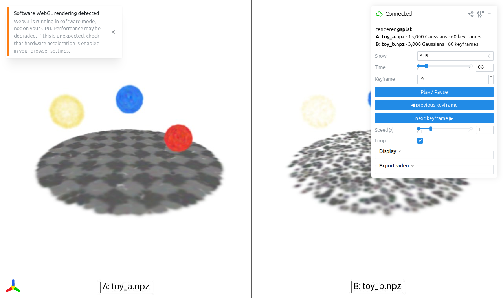
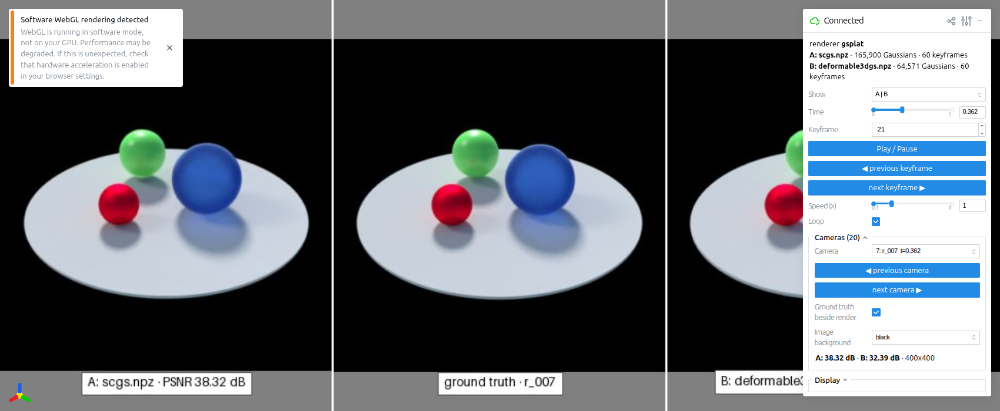
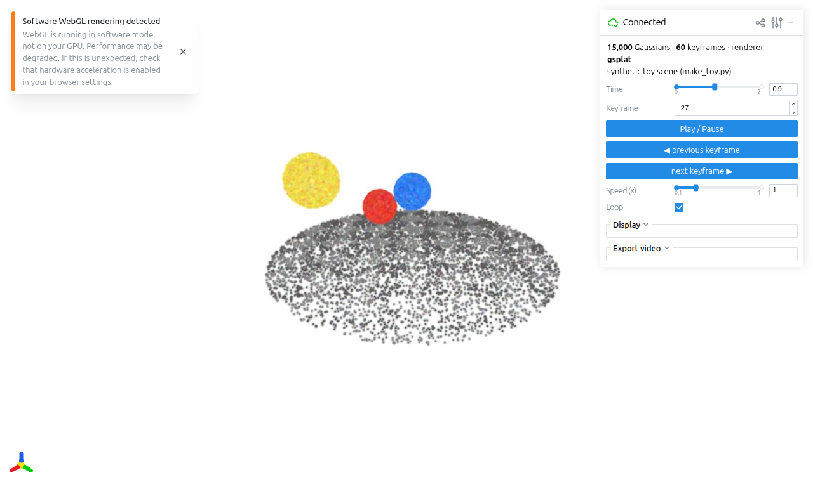
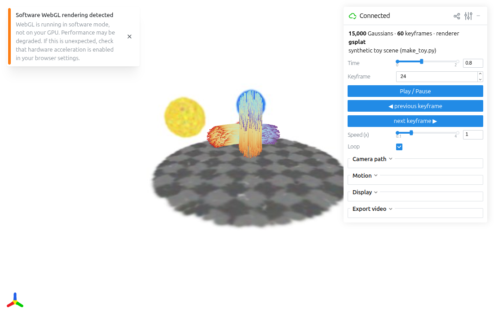

# User guide

How to open the output of a 4DGS method, use the viewer, and run the tests. What the tool does and how it is validated is
described in [METHOD.md](METHOD.md); measurements are in [SUPPORTED.md](SUPPORTED.md), [PERFORMANCE.md](PERFORMANCE.md) and
[FORMAT.md](FORMAT.md).

Installation: see the [README](../README.md#installation).

## Opening an output directly: `python -m gs4d.open`

```bash
python -m gs4d.open <output_path> [--reconvert] [--dry-run] [--convert-args "--stride 4"]
                    [viewer.py arguments]
```

- Recognised (checked in this order, the first match wins, nothing is guessed): an `.npz` already in the common format (opened as it
  is); `params.npz` or a folder of per-frame ply files; `chkpnt*.pth`; other `.ckpt` / `.pth` files by the key names in the checkpoint
  (the pickle is read without torch; when it cannot be read, by the file name): `step-*.ckpt` of 4D-Rotor GS, `last.ckpt` of Shape of
  Motion, `photometric_d_model_*.pth` of MoSca; a folder with `checkpoints/last.ckpt`, `nerfstudio_models/` (the last step) or a MoSca
  log; a folder with `point_cloud/` + `deform/` (SC-GS when the ply has `fea_*` columns, else Deformable-3DGS); a folder with
  `point_cloud/iteration_*/deformation.pth` (E-D3DGS when the ply has `embedding_*` columns, else 4DGaussians); the `point_cloud.ply`
  of Spacetime Gaussians.
- The converted file is `<name>.gs4d.npz` next to the output and is reused while the output and the converter are unchanged;
  `--reconvert` converts again, `--dry-run` only prints the commands. When the estimated file is larger than 1 GB the conversion uses
  `--compact`.
- D-NeRF scenes (`cfg_args` says dnerf / is_blender) get the time range [0, 1].
- Cameras: unless you pass `--cameras` yourself, a readable `cameras.json` (next to the output or up to 3 folders above it) or the
  `transforms_test.json` of the dataset named in `cfg_args` is passed to the viewer. For Nerfies / HyperNeRF datasets (4DGaussians,
  Deformable-3DGS, SC-GS) the held-out cameras are written to `<name>.gs4d.cameras.json` next to the output.
- An output that is not recognised prints the checks that were made and exits with code 2. Ctrl+C stops the viewer and a running
  converter.

## Inputs and converters

| Type | Method | Input | Converter | Checked on a real output |
|---|---|---|---|---|
| A | Gaussians per frame (feed-forward models; the per-frame export of 4DGaussians) | folder of `*.ply` | `convert_per_frame.py` | yes |
| A | Dynamic 3D Gaussians | `params.npz` | `convert_per_frame.py` | yes (no original images) |
| B | Native 4DGS (Yang et al., ICLR 2024) | `chkpnt*.pth` | `convert_native4d.py` | yes |
| B | 4D-Rotor GS (SIGGRAPH 2024) | `step-*.ckpt` (Nerfstudio) | `convert_4drotor.py` | no, synthetic test only |
| C | Spacetime Gaussians (lite model) | `point_cloud.ply` | `convert_spacetime.py` | yes |
| C | Shape of Motion | `checkpoints/last.ckpt` | `convert_shape_of_motion.py` | yes |
| C/D | MoSca (CVPR 2025), dynamic Gaussians only | `photometric_d_model_*.pth` | `convert_mosca.py` | no, synthetic test only |
| D | 4DGaussians (hustvl) | model folder | `convert_4dgaussians.py` | yes |
| D | Deformable-3DGS | model folder | `convert_deformable3dgs.py` | yes |
| D | SC-GS | model folder `<name>_node` | `convert_scgs.py` | yes |
| D | E-D3DGS (ECCV 2024) | model folder | `convert_ed3dgs.py` | no, synthetic test only |

`python -m gs4d.open` runs the right converter for you. By hand: `python converters/<converter> <input> -o scene.npz [flags]`, for example
`python converters/convert_native4d.py chkpnt_best.pth -o scene.npz --frames 60 --t0 0 --t1 1 --sh`; the command of every method is in
[SUPPORTED.md](SUPPORTED.md).

Types: **A** Gaussians per frame · **B** 4D Gaussians sliced in time · **C** parametric motion functions · **D** deformation networks,
re-run on the CPU. PSNR per method, the variants that were tried, the variants a converter refuses and why:
[SUPPORTED.md](SUPPORTED.md). Adding a method: [ADD_A_CONVERTER.md](ADD_A_CONVERTER.md) (with a working
`converters/convert_template.py`).

Flags shared by the converters: `--frames` number of keyframes (types B, D); `--t0 --t1` time range in the method's unit (D-NeRF
scenes: [0, 1]); `--fps` and `--stride` for per-frame outputs; `--sh` keeps view-dependent colour (used by the gsplat renderer only,
bigger file); `--compact` writes the compact layout. `python converters/<converter> --help` lists every flag.

## Using the viewer

```bash
python viewer.py scene.npz [--renderer auto|gsplat|client] [--up +z] [--port 8080]
                 [--compare b.npz] [--cameras transforms_test.json]
```

Scenes from COLMAP usually need `--up -y`; Blender / D-NeRF scenes use `+z` (the default).

### Renderers

- `--renderer gsplat`: rasterises with gsplat on the NVIDIA GPU of the machine that runs the viewer and streams the image to the browser.
  For real scenes (hundreds of thousands to millions of Gaussians). View-dependent colour (`sh`) exists only in this renderer.
- `--renderer client`: sends the Gaussians to the browser, which draws them with WebGL. No CUDA needed; suits a laptop and small scenes;
  limited to the 300,000 most opaque Gaussians by default (`--max-splats`).
- `--renderer auto` (default): gsplat when CUDA is available, else client.

Measured speed: [PERFORMANCE.md](PERFORMANCE.md) (gsplat at 1280×720 about 14 ms per frame for a small scene; fetching one
frame of a scene with 1 million Gaussians while playing takes 3 ms).

### Moving the camera

| Action | Result |
|---|---|
| Left drag | orbit around the point you look at |
| Right drag | pan the camera sideways / up and down |
| Mouse wheel, or middle drag | move closer to / away from the point you look at |
| `W` / `S` | forward / backward, horizontally |
| `A` / `D` | left / right |
| `Q` / `E` | down / up along the scene's up axis (`--up`) |
| Arrow keys | orbit around the point you look at |

Keys work only while the pointer is over the scene (not over the control panel).

### Comparing two results: `--compare`

```bash
python viewer.py ours.npz --compare baseline.npz
```

Both files share the time slider, the play button and the camera. **Show** selects `A`, `B` or `A | B` (side by side, the default);
switch between `A` and `B` from the same viewpoint to spot differences. The gsplat renderer splits the screen, each half drawing one file
from the same camera; the client renderer places B to the right of A in the same scene, with a file-name label. The time slider spans
from the earliest to the latest keyframe of both files; both files must share the coordinate frame and the up axis.



### Training cameras and original images: `--cameras`

```bash
python viewer.py bouncingballs.npz \
    --cameras ../data/dnerf/bouncingballs/transforms_test.json
```

`--cameras` takes a `transforms_*.json` (NeRF / D-NeRF / instant-ngp, OpenGL cameras) or a `cameras.json` (`{"convention":
"opencv"|"opengl", "frames": [{"c2w": [[4x4]], "fx" or "fov_x"/"fov_y", "w", "h", "time", "image", "name"}]}`). The **Cameras** folder in the
control panel lists the cameras; selecting one moves the view to it and the time slider to the time of its image.

With the gsplat renderer, **Ground truth beside render** shows the render next to the original image of the selected camera, with its
**PSNR** (same recipe as `tests/check_real.py`; the two Display sliders do not apply, so the number is the model's own). Set **Max render
height** to the resolution the model was trained at (for example 400 for SC-GS and native 4DGS on D-NeRF), and **Image background** to
white for models trained on a white background (4DGaussians): a different resolution costs several dB of PSNR. With `--compare` it shows
three panels, **render A | original image | render B**, with the PSNR of both.



### Points

**Display** → **Draw as**: `splats` (the Gaussians as usual) or `points` (one point at each Gaussian's centre, in the Gaussian's colour),
and the **Point size** slider. Open directly in points mode: `--draw-as points`. Works while playing, with `--compare`, during video
export, in both renderers; **Hide opacity below** still applies. The gsplat renderer draws every point as an opaque round Gaussian whose
diameter is **Point size** pixels at any depth (near points hide far ones in the right order, view-dependent colour stays correct); the
client renderer uses viser's point cloud (point size in scene units).



### Speed and motion trails

The **Motion** folder (only when the keyframes share Gaussian identities):

- **Colour by**: `colour` (the Gaussian's own colour), `speed` (magnitude of the velocity between the two neighbouring keyframes) or
  `displacement` (distance from the position at the first keyframe). Scale blue → green → yellow → red; the value shown as red is written
  in the panel (99th percentile over the whole sequence × "Scale maximum (%)").
- **Trails**: the paths of "Number of trails" Gaussians over a window of ± "Window" around the current time (blue = past, red = future),
  drawn at random with a weight that grows with path length, among Gaussians that are opaque enough. Trails are lines drawn over the
  picture: with the gsplat renderer they are not hidden by depth.



### Camera path

The **Camera path** folder: move the camera, then press **Add key from my camera** to place a key (drawn as an orange camera frustum, with
the path in the scene), or **Replace by an orbit around the scene** to get a ready-made loop of 12 keys around the scene. Positions are
interpolated with a Catmull-Rom spline, orientations with slerp, the field of view linearly.

- **Play / stop path** runs the path over "Path duration (s)" and drives the camera of every connected browser; drag "Path position" to
  look at any point of it. **Scene time on the path**: stay at the current time, or run through the sequence while the camera moves.
- **Save path (json)** writes to `--camera-path` (or `<video-dir>/camera_path.json`) and downloads the file; load it again with
  `python viewer.py scene.npz --camera-path path.json`. Same convention as `--cameras`: `{"convention", "duration", "closed",
  "time": "hold"|"run", "frames": [{"c2w": [[4x4]], "fov_y": radians}]}`.

### Video export

The **Export video** folder: choose "Frames per second", "Video length (s)" and "Camera" (`this camera (fixed)` or `camera path`), then
press **Export mp4**. The file `<name>_<date_time>.mp4` is written to `--video-dir` (default: the current folder) on the machine that runs
the viewer, and downloaded in the browser. The gsplat renderer renders directly on the GPU (60 frames at 1280×720 in about 1 second); the
client renderer has to wait for the browser to draw every frame, which is much slower. While exporting, the viewer stops updating every
browser.

### Viewing from another machine

Viewer on the GPU machine, browser on another one: `ssh -L 8080:localhost:8080 <gpu_machine>`, then open `http://localhost:8080`.
Or run the viewer with `--host 0.0.0.0` to accept connections from the network (trusted networks only).

## File format

One `.npz` file with `times [K]`, `means [K,N,3]`, `covs [K,N,6]` (upper triangle of the covariance), `opacities [K,N]`, `colors [K,N,3]`
and optionally `sh`; a field without the K axis is constant over time. There is a compact layout (`--compact`, or
`python -m gs4d in.npz out.npz`), Gaussians that never change are stored once, and `Sequence4DWriter` writes one keyframe at a time when
the scene does not fit in memory. Details and measurements: [FORMAT.md](FORMAT.md).

```python
from gs4d import Sequence4D
# lazy: memory-maps the file, only the keyframes used are read
seq = Sequence4D.load("scene.npz", lazy=True)
# Gaussians at t = 0.5 (interpolated between two keyframes)
means, covs, opacities, colors = seq.at(0.5)
```

## Tests

```bash
# every tests/test_*.py and tests/check_*.py, one at a time;
# prints pass / skipped (with the reason) / failed
python tests/run_all.py
python tests/run_all.py open sh    # only the files whose name contains one of the words
ruff check .                       # lint, as in CI
```

- `tests/test_*.py`: CPU checks. Every converter runs on synthetic files in the method's real layout and is compared with an independent
  formulation (needs torch); the format, compact storage, the static group, `Sequence4DWriter`, `GpuFrames`, `gs4d.open`, the error
  messages of the commands.
- `tests/check_*.py`: open the viewer in headless Chrome and check screenshots (needs Playwright + Chrome; the gsplat parts need CUDA). The
  screenshots of a `run_all.py` run go to a temporary folder; run a script on its own (or `run_all.py --keep-shots`) to keep them
  in `shots/`, which git ignores; the images shown in these docs are in `docs/images/`.
- `tests/check_real.py`: PSNR with thresholds on real outputs of every method (needs CUDA and the real data, see the top of the file).
- A file that lacks what it needs (torch, CUDA, Chrome, data) is reported as "skipped" with the reason, not as failed. GitHub Actions runs
  the lint, the tests without torch and the tests with CPU torch on every push.
